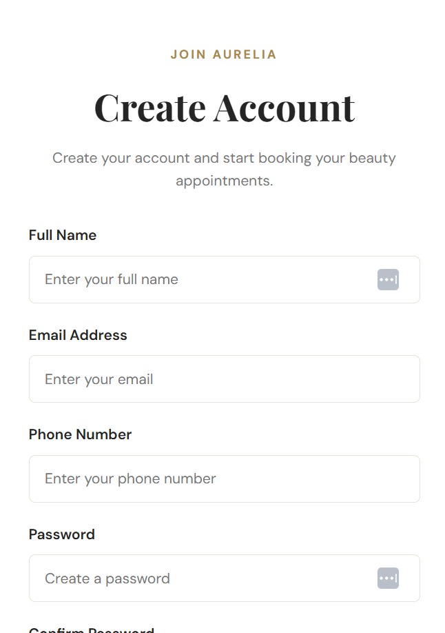
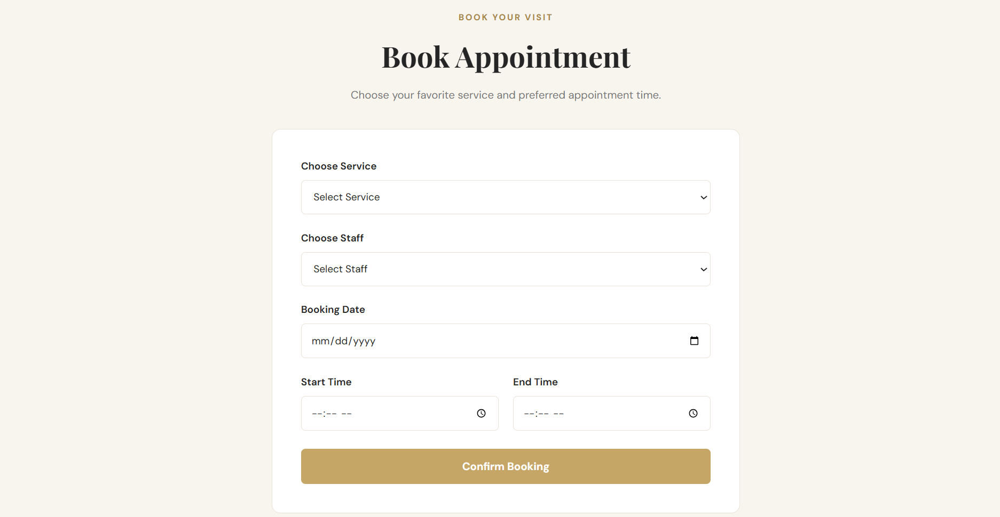
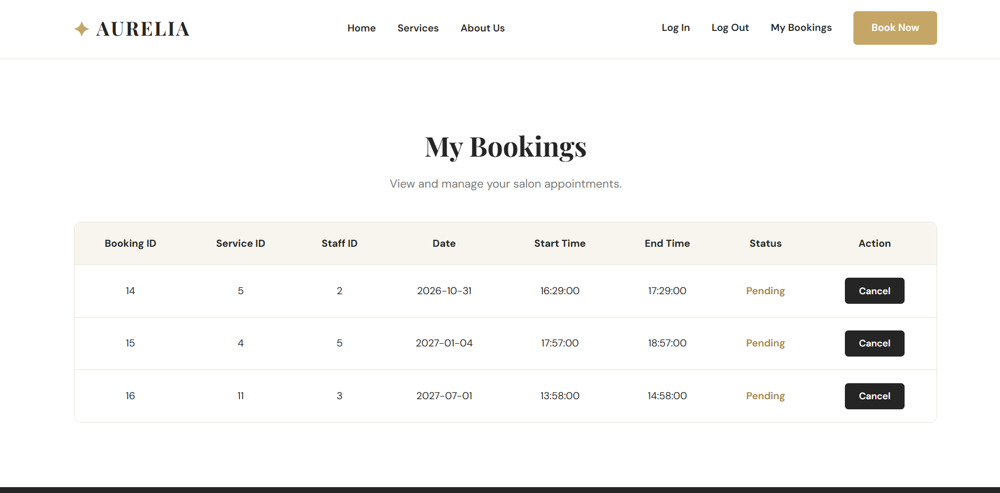
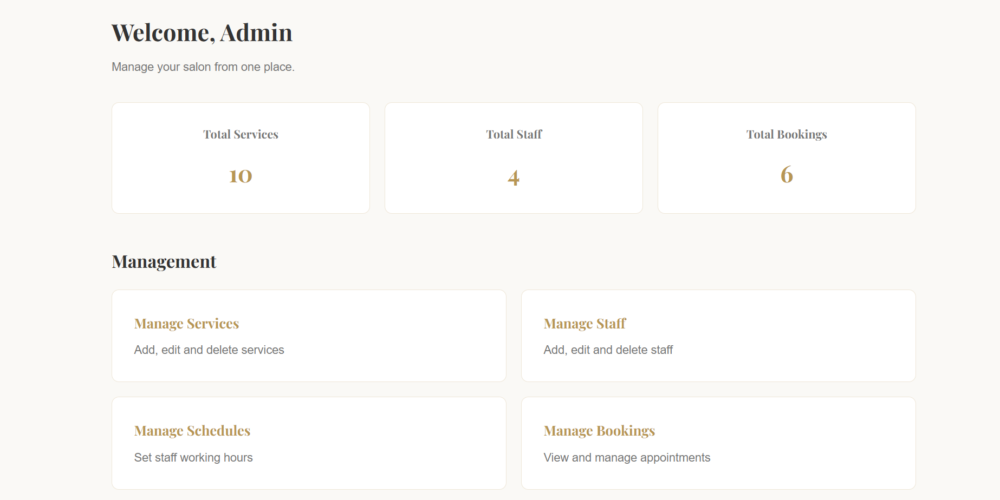
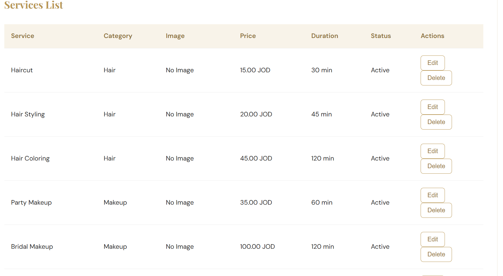
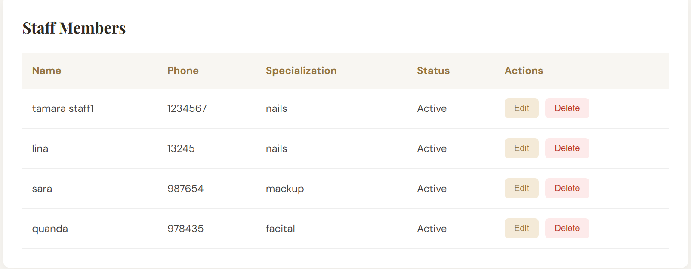

<div align="center">

# ✨ AURELIA

### Salon Booking Management System

A modern salon booking system designed to simplify appointment scheduling, service management, and customer reservations.

**PHP • MySQL • HTML • CSS • JavaScript**

**Simple • Elegant • Organized**

</div>

---

## 📖 About the Project

**AURELIA** is a web-based salon booking management system designed to make appointment scheduling easier for customers and salon administrators.

Customers can browse salon services, book appointments, manage their bookings, and leave reviews.

Administrators can manage services, staff members, working schedules, and customer appointments through an admin dashboard.

The project is developed using **PHP Object-Oriented Programming (OOP)**, MySQL, HTML, CSS, and JavaScript.

---

## 📸 Project Screenshots

### 🏠 Home Page


### 🔐 Login Page


### 📝 Register Page



### 📅 Book Appointment



### 📋 My Bookings



### 📊 Admin Dashboard



### 💇 Services Management



### 🕒 Staff Schedules



---

## 🚀 Features

### 👤 Customer Features

- Create a new account
- Log in and log out
- Browse salon services
- Select a service
- Choose a staff member
- Select an appointment date and time
- Book appointments
- View personal bookings
- Cancel appointments
- Leave reviews for completed appointments

### 🛠️ Admin Features

- Access admin dashboard
- Manage salon services
- Manage service categories
- Manage staff members
- Manage staff working schedules
- View customer bookings
- Update booking statuses
- Manage salon appointments

---

## 🛠️ Technologies Used

| Technology | Purpose |
|------------|---------|
| HTML5 | Website structure |
| CSS3 | Styling and responsive design |
| JavaScript | Frontend interactions |
| PHP | Backend development |
| PHP OOP | Object-oriented programming |
| MySQL | Database management |
| PDO | Database connection and queries |
| XAMPP | Local development environment |
| Git & GitHub | Version control |

---

## 👥 User Roles

The system supports two main user roles.

### 👤 Customer

Customers can register, log in, browse services, make appointments, cancel bookings, and submit reviews.

### 🛠️ Admin

Administrators can manage services, staff, schedules, and bookings through the admin dashboard.

---

## 🗄️ Database Structure

The project uses a MySQL database named `salon_booking`.

The database contains eight tables:

| Table | Description |
|-------|-------------|
| users | Stores customer and admin accounts |
| categories | Stores salon service categories |
| services | Stores salon services |
| staff | Stores staff information |
| staff_schedules | Stores staff working schedules |
| staff_services | Connects staff members with services |
| bookings | Stores customer appointments |
| reviews | Stores customer reviews |

The database schema is available in:

`database/salon_booking.sql`

---

## 📁 Project Structure

    salon-booking-system/
    │
    ├── admin/
    ├── assets/
    ├── classes/
    │   ├── Auth.php
    │   ├── Booking.php
    │   ├── Database.php
    │   ├── Review.php
    │   ├── Schedule.php
    │   ├── Service.php
    │   └── Staff.php
    │
    ├── css/
    │   ├── main.css
    │   └── auth.css
    │
    ├── customer/
    ├── database/
    │   └── salon_booking.sql
    │
    ├── includes/
    │   ├── navbar.php
    │   └── footer.php
    │
    ├── js/
    │   └── main.js
    │
    ├── pages/
    │   ├── login.php
    │   ├── register.php
    │   └── logout.php
    │
    ├── screenshots/
    │   ├── home.png
    │   ├── login.png
    │   ├── Register.png
    │   ├── book.png
    │   ├── my-booking.png
    │   ├── admin-dashboard.png
    │   ├── ser-list.png
    │   └── admin-schedules.png
    │
    ├── uploads/
    ├── index.php
    └── README.md

---

## ⚙️ Installation & Setup

### 1. Install XAMPP

Download and install XAMPP:

https://www.apachefriends.org/

### 2. Clone the Repository

```bash
git clone https://github.com/tamaraqweder/salon-booking-system.git
```

### 3. Move the Project

Place the project folder inside:

`C:\xampp\htdocs\salon-booking-system`

### 4. Start XAMPP

Open the XAMPP Control Panel and start:

- Apache
- MySQL

### 5. Import the Database

Open phpMyAdmin:

http://localhost/phpmyadmin

Import the SQL file:

`database/salon_booking.sql`

### 6. Configure Database Connection

Open:

`classes/Database.php`

Make sure the database connection settings match your local MySQL configuration.

### 7. Run the Project

Open your browser and visit:

http://localhost/salon-booking-system/

---

## 🔄 Booking Workflow

1. Customer registers or logs in.
2. Customer browses salon services.
3. Customer selects a service.
4. Customer chooses a staff member.
5. Customer selects an appointment date and time.
6. The system checks appointment availability.
7. Customer confirms the booking.
8. The booking appears in My Bookings.
9. Customer can leave a review after the appointment is completed.

---

## 📌 Booking Statuses

The system supports the following appointment statuses:

| Status | Description |
|--------|-------------|
| Pending | Appointment is awaiting confirmation |
| Confirmed | Appointment has been confirmed |
| Completed | Appointment has been completed |
| Cancelled | Appointment has been cancelled |

---

## 🔒 Security & Validation

The project includes:

- Password hashing using PHP
- Password verification during login
- Session-based authentication
- Role-based access control
- PDO prepared statements
- Server-side form validation
- Booking ownership verification
- Appointment availability checks

---

## 🎯 Project Objectives

- Simplify salon appointment booking
- Reduce manual booking management
- Organize staff working schedules
- Prevent conflicting appointments
- Improve the customer booking experience
- Provide centralized salon administration

---

## 🔮 Future Improvements

Possible future enhancements include:

- Email appointment notifications
- Online payments
- Appointment reminders
- Advanced reporting and analytics
- Additional interactive frontend features

---

## 📌 Project Status

**Academic Project — Under Development**

AURELIA is being developed as a salon booking management system for educational purposes.

---

<div align="center">

### ✨ AURELIA

**Beauty Meets Simplicity**

Built with PHP & MySQL.

</div>
