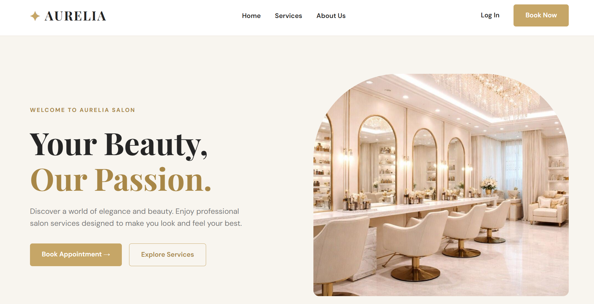
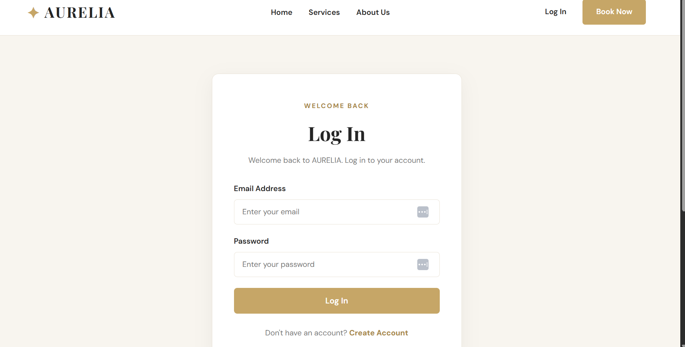

# ✨ AURELIA
### Salon Booking Management System

A web-based salon booking system built with PHP, MySQL, HTML, CSS, and JavaScript.

**Simple • Elegant • Organized**

---

## 📖 About the Project

AURELIA is a salon booking management system designed to make appointment scheduling easier for customers and salon administrators.

Customers can browse services, book appointments, manage their bookings, and leave reviews.

Administrators can manage salon services, staff members, working schedules, and appointments.

---

## 📸 Project Screenshots

### 🏠 Home Page

### 🔐 Login Page

### 📝 Register Page

### 📅 Book Appointment

### 📋 My Bookings

### 📊 Admin Dashboard

### 💇 Services Management

### 🕒 Staff Schedules

---

## 🚀 Features

### 👤 Customer

- Register and log in
- Browse salon services
- Book appointments
- Select staff members
- Choose appointment dates and times
- View personal bookings
- Cancel appointments
- Leave reviews for completed appointments

### 🛠️ Admin

- Access admin dashboard
- Manage services
- Manage service categories
- Manage staff members
- Manage staff schedules
- View customer bookings
- Update booking statuses

---

## 🛠️ Technologies Used

| Technology | Purpose |
|------------|---------|
| HTML5 | Website structure |
| CSS3 | Website styling |
| JavaScript | Frontend functionality |
| PHP | Backend development |
| PHP OOP | Object-oriented programming |
| MySQL | Database |
| PDO | Database connection |
| XAMPP | Local server |
| Git & GitHub | Version control |

---

## 🗄️ Database

The database is named `salon_booking` and contains 8 tables:

1. users
2. categories
3. services
4. staff
5. staff_schedules
6. staff_services
7. bookings
8. reviews

Database schema:

`database/salon_booking.sql`

---

## 📁 Project Structure

    salon-booking-system/
    │
    ├── admin/
    ├── assets/
    ├── classes/
    ├── css/
    ├── customer/
    ├── database/
    ├── includes/
    ├── js/
    ├── pages/
    ├── screenshots/
    ├── uploads/
    ├── index.php
    └── README.md

---

## ⚙️ Installation

### 1. Install XAMPP

Download XAMPP from:

https://www.apachefriends.org/

### 2. Move the Project

Place the project folder inside:

`C:\xampp\htdocs\salon-booking-system`

### 3. Start the Server

Open XAMPP and start:

- Apache
- MySQL

### 4. Import the Database

Open:

http://localhost/phpmyadmin

Import:

`database/salon_booking.sql`

### 5. Configure Database

Check the connection settings inside:

`classes/Database.php`

### 6. Run the Project

Open:

http://localhost/salon-booking-system/

---

## 🔄 Booking Process

1. Register or log in
2. Browse salon services
3. Select a service
4. Choose a staff member
5. Select a date and time
6. Confirm the booking
7. View the appointment in My Bookings
8. Leave a review after completion

---

## 🔒 Security

- Password hashing
- Session-based authentication
- Role-based access control
- PDO prepared statements
- Server-side validation
- Booking availability checks

---

## 📌 Project Status

Academic Project — Under Development

---

### ✨ AURELIA

**Beauty Meets Simplicity**

Built with PHP & MySQL.

